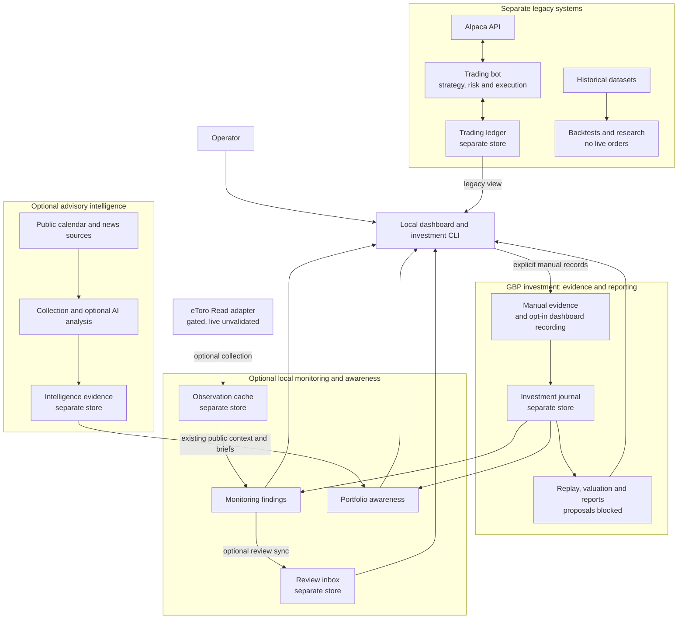

# GoldScout

GoldScout's primary direction is a long-term GBP portfolio manager for
designated investment capital. The current investment system records and reports
operator-supplied evidence. It does not choose investments, execute trades, or
verify that recorded account data is true.

## What exists today

| Area | Current capability |
| --- | --- |
| Investment records | Separate GBP-only v1/v2 journals, replayed reports, and explicit v2 opening evidence. |
| Portfolio policy | Core/dynamic/unassigned attribution is recorded in v2; approved role budgets and policy are not implemented. Investment proposals are blocked. |
| Portfolio awareness | Optional local projection of configured exposures against existing intelligence evidence; no collection or trading authority. |
| Portfolio monitoring | Local evidence-quality, concentration, role-share and review findings; separate observation cache, a local review inbox and gated eToro Read snapshot adapter, live unvalidated. |
| Market intelligence | Separate opt-in calendar/news collection and analysis. Advisory only; it cannot change investment records or direct trades. |
| Legacy trading | The Alpaca bot remains available as a separate system with its own ledger, configuration, and recovery contracts. It is not the investment manager. |
| Research | Legacy strategy experiments and GBP data-readiness tools are separate from an approved GBP portfolio-performance process. See the [research protocol](docs/backtesting-protocol.md). |

The illustrative core/dynamic range is not an approved allocation. See the
[investment guide](docs/investment.md) for supported operations and blockers,
and the [investor mandate](docs/investment-research-context.md) for the agreed
product direction.

## Architecture



The dashboard is read-only by default; setup and later recording have separate
confirmation and opt-in gates. Monitoring collection and review workflows have
separate gates. Intelligence supplies advisory context only, not trading or
investment authority. The dashboard selects recorded investment or legacy data,
while demo data is synthetic. See the [monitoring](docs/monitoring.md),
[intelligence](docs/intelligence.md) and [legacy systems](docs/legacy-systems.md)
guides for details and limitations.

## Start the local investment workspace

With the documented dependencies and frontend build available, run:

```powershell
python -m dashboard
```

In a source checkout this selects the Git-ignored `local-investment/` workspace.
If it is absent or empty, the dashboard displays a guided setup screen; enter
accounts, products and dated opening evidence, review the preview and explicitly
confirm creation. No login, profile JSON editing or separate initialization
command is needed. No files are created by startup, viewing setup or previewing
a draft.

An existing valid journal opens read-only. Damaged, unexpected or conflicting
files show recovery guidance, never an automatic reset. Subsequent manual
recording requires a separate launch with `--investment-recording`. Account/product
scope is fixed at creation in this release.
An installed package outside a source checkout requires `--workspace <directory>`;
it never writes into the installed package. See the [onboarding guide](docs/investment.md#guided-first-run-setup).

## Try the offline demos

From the repository root, with the documented dependencies installed:

```powershell
python -m investment demo
python -m dashboard --demo
```

The investment command prints a synthetic report without creating a store. The
dashboard command serves synthetic data; build the frontend first as described
in the [dashboard guide](docs/dashboard.md). The dashboard opens the GBP
investment view with synthetic v2 opening evidence; its separate legacy trading
demo remains at `/legacy`. Neither command starts the trading bot or accesses a
broker.

An explicit `--investment-database` still selects only an existing journal and
never falls back to setup. Dashboard investment recording is off unless separately
enabled and bound to that store. The local dashboard has no user login; keep it
on its default loopback address and do not expose or tunnel it. See the
[investment guide](docs/investment.md) and [dashboard guide](docs/dashboard.md)
before using recorded data.

## Project map

- [`investment/`](investment/) — GBP accounting, replay, reports, and review status.
- [`dashboard/`](dashboard/) and [`frontend/`](frontend/) — local read-only views, with explicitly enabled v2 recording.
- [`market_intelligence/`](market_intelligence/) — separate optional advisory service and store.
- [`bot/`](bot/) — retained Alpaca trading, ledger, and legacy research tools; see the [detailed system reference](docs/legacy-systems.md).
- [`tests/`](tests/) and [`scripts/`](scripts/) — offline regressions and development checks.

## Guides

- [Investment operations and limitations](docs/investment.md)
- [Investment journal backup, restore and capacity](docs/investment-journal.md)
- [Portfolio awareness and observation preview](docs/portfolio-automation.md)
- [Monitoring operations and activation gates](docs/monitoring.md), [provider assessment](docs/provider-feasibility.md)
- [Market intelligence](docs/intelligence.md)
- [GBP research protocol](docs/backtesting-protocol.md) and [campaign data](docs/campaign-dataset.md)
- [Legacy trading, ledger, and research reference](docs/legacy-systems.md)
- [Development workflow](docs/development.md) and [safety invariants](docs/safety-invariants.md)

Default to offline development. Do not start the trading engine, use broker
credentials, access operational stores, or make external calls without
task-specific approval. Offline tests do not establish broker behavior,
investment suitability, or profitability.
